## 一、问题背景：当多个租户共享一个线程池

想象你在一个微服务网关层工作。每秒有数十万请求涌入，它们来自不同的租户——有核心 API 服务（要求毫秒级响应）、有 CDN 合作伙伴（中等优先级）、有数据分析服务（可容忍延迟）、还有免费试用用户（尽力而为）。

所有这些请求共享同一个线程池。

问题来了：**如何保证核心租户在系统过载时依然获得优先服务，同时不让低优先级租户完全饿死？**

这不是一个简单的"设置线程优先级"就能解决的问题。Java 的 `Thread.setPriority()` 在现代操作系统上几乎没有实际效果，而且线程池中的线程是复用的，优先级会被继承和污染。

我们需要的是一套**应用层的调度引擎**——在线程池之上，自己实现公平性、限流、背压和熔断。

本文将完整拆解这样一个多租户自适应调度引擎的设计与实现。

## 二、整体架构总览

先看全局视角，理解各组件之间的关系：

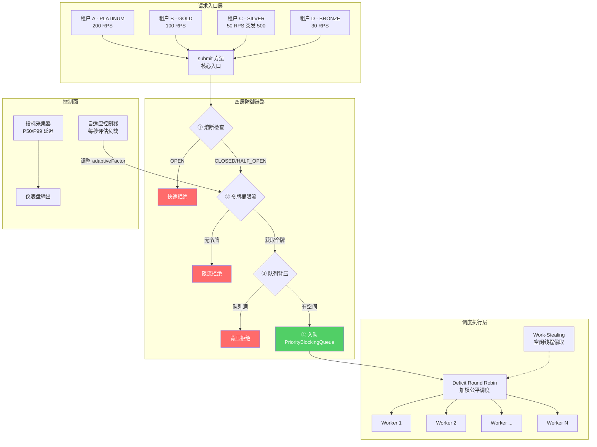


## 三、租户 SLA 模型：用枚举定义资源配额

一切的起点是租户分级。不同等级的租户拥有不同的资源配额：

```java
public enum TierLevel {
    PLATINUM(8, 10000, 500), // 权重8，令牌桶容量10000，队列深度500
    GOLD(4, 5000, 300),
    SILVER(2, 2000, 200),
    BRONZE(1, 1000, 100);

    final int weight;              // 调度权重：决定获得多少 CPU 时间片
    final int tokenBucketCapacity; // 令牌桶容量：决定突发流量的承受能力
    final int maxQueueDepth;       // 最大队列深度：决定背压触发阈值
}
```

三个维度的配额形成了一个**立体的资源控制模型**：

| 维度 | PLATINUM | GOLD | SILVER | BRONZE | 含义 |
|------|----------|------|--------|--------|------|
| weight | 8 | 4 | 2 | 1 | 每轮调度获得的任务执行配额 |
| tokenBucketCapacity | 10000 | 5000 | 2000 | 1000 | 能承受的最大突发请求量 |
| maxQueueDepth | 500 | 300 | 200 | 100 | 排队等待的最大任务数 |
| 令牌补充速率 | 4000/s | 2000/s | 1000/s | 500/s | weight × 500 |

PLATINUM 租户的令牌补充速率是 BRONZE 的 8 倍，队列容量是 5 倍。这意味着在系统过载时，BRONZE 租户会最先被限流和背压拒绝，而 PLATINUM 租户几乎不受影响。

## 四、submit 方法：四层防御的分层漏斗

`submit` 是整个引擎的核心入口，每个请求都要经过四道关卡。设计哲学是：**成本最低的检查放最前面，成本最高的操作放最后面**。

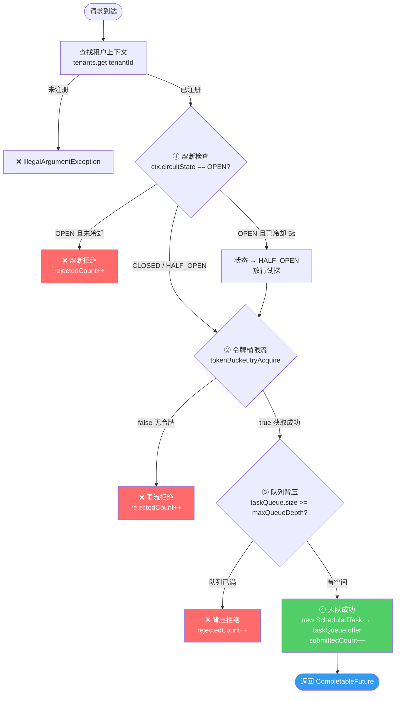

### 4.1 为什么这个顺序很重要？

每一步的计算成本递增：

| 步骤 | 操作 | 成本 | 拒绝场景 |
|------|------|------|----------|
| ① 熔断检查 | 一次 volatile 读 | ~1ns | 下游服务连续故障 |
| ② 令牌桶 | CAS 自旋 + 时间计算 | ~10-50ns | 请求速率超限 |
| ③ 队列背压 | `size()` 调用 | ~10ns | 消费速度跟不上生产 |
| ④ 入队 | 对象创建 + 堆插入 | ~100-500ns | 正常路径 |

在系统过载时，绝大多数请求在前两步就被弹回去了，根本不会走到创建对象、操作队列那一步。**系统越忙，拒绝越快，资源消耗反而越少**——这就是分层漏斗的精髓。

### 4.2 每一步的深度解析

#### Step 1：熔断检查——最后一道防线

```java
if (ctx.circuitState == CircuitState.OPEN) {
    if (System.currentTimeMillis() - ctx.lastFailureTimestamp > 5000) {
        ctx.circuitState = CircuitState.HALF_OPEN; // 冷却后试探
    } else {
        ctx.rejectedCount.incrementAndGet();
        return CompletableFuture.failedFuture(...);  // 秒拒
    }
}
```

熔断器是三态状态机：

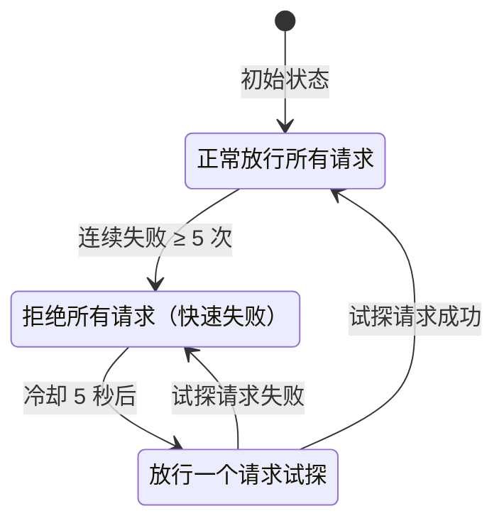

关键设计点：
- **OPEN 状态下是零成本拒绝**：一次 volatile 读 + 一次时间比较，不涉及任何锁或 CAS
- **HALF_OPEN 是自愈机制**：不需要人工干预，冷却后自动试探恢复
- **连续失败计数器用 AtomicInteger**：在 `executeTask` 中递增，成功时归零

#### Step 2：自适应令牌桶——CAS 无锁限流

这是整个引擎中并发设计最精妙的部分。

```java
boolean tryAcquire() {
    refill();  // 先补充令牌
    while (true) {
        long current = tokens.get();
        if (current <= 0) return false;           // 无令牌，拒绝
        if (tokens.compareAndSet(current, current - 1))
            return true;                           // CAS 成功，获取令牌
        // CAS 失败 → 自旋重试（比 synchronized 高效）
    }
}
```

**为什么不用 `synchronized` 或 `ReentrantLock`？**

在每秒数十万请求的场景下，锁竞争会成为严重瓶颈。CAS 自旋的优势在于：
- 无上下文切换：失败后立即重试，不会被挂起
- 无内核态切换：纯用户态操作
- 在低竞争时几乎零开销：一次 CAS 就成功

令牌补充的 `refill()` 方法同样精巧：

```java
private void refill() {
    long now = System.nanoTime();
    long elapsed = now - lastRefillTime;
    if (elapsed < 1_000_000) return; // 至少 1ms 才补充，减少无效计算

    long tokensToAdd = (long)(elapsed / 1_000_000_000.0 * refillRate * adaptiveFactor);
    if (tokensToAdd > 0) {
        lastRefillTime = now;
        tokens.getAndUpdate(current -> Math.min(capacity, current + tokensToAdd));
    }
}
```

注意 `adaptiveFactor` 这个自适应因子——它不是静态的，而是由自适应控制器根据全局负载动态调整：

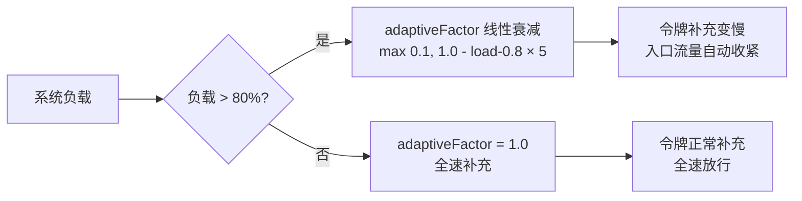

| 系统负载 | adaptiveFactor | 效果 |
|----------|---------------|------|
| 0% - 80% | 1.0 | 全速补充，不限流 |
| 85% | 0.75 | 补充速率降至 75% |
| 90% | 0.50 | 补充速率降至 50% |
| 95% | 0.25 | 补充速率降至 25% |
| 100% | 0.10 | 补充速率降至 10%（保底） |

这意味着系统在"喘不过气"的时候自动收紧入口，恢复后又自动放开，比写死一个阈值优雅得多。

#### Step 3：队列深度背压——防止内存溢出

```java
if (ctx.isQueueFull()) {  // taskQueue.size() >= tier.maxQueueDepth
    ctx.rejectedCount.incrementAndGet();
    return CompletableFuture.failedFuture(
        new RejectedExecutionException("[背压] 队列已满"));
}
```

背压（Backpressure）的核心思想：**如果消费者处理不过来，就主动告诉生产者"别发了"**。

这里的实现很直接——队列满了就拒绝。但配合前面的令牌桶，形成了双重保护：
- 令牌桶控制**速率**（每秒多少个）
- 队列深度控制**总量**（最多积压多少个）

两者缺一不可：只有令牌桶，突发流量可能瞬间填满内存；只有队列深度，稳定的高速率流量会持续堆积。

#### Step 4：入队——终于到了正常路径

```java
ScheduledTask<T> task = new ScheduledTask<>(tenantId, priority, work);
ctx.taskQueue.offer(task);  // PriorityBlockingQueue，按优先级排序
ctx.submittedCount.incrementAndGet();
return task.resultFuture;   // 返回 CompletableFuture
```

任务被封装为 `ScheduledTask`，它实现了 `Comparable` 接口：

```java
public int compareTo(ScheduledTask other) {
    int cmp = Integer.compare(this.priority, other.priority);
    return cmp != 0 ? cmp : Long.compare(this.enqueueTimeNano, other.enqueueTimeNano);
}
```

先按优先级排序（数值越小越优先），同优先级按入队时间 FIFO。这保证了同一租户内部的请求也是公平的。

返回的 `CompletableFuture` 让调用方可以：
- `thenApply()` 链式处理结果
- `exceptionally()` 处理异常
- `orTimeout()` 设置超时
- `join()` 同步等待

## 五、调度核心：Deficit Round Robin + Work-Stealing

任务入队后，由 Worker 线程负责消费。这里用了两个经典算法的组合。

### 5.1 Deficit Round Robin（DRR）——加权公平调度

DRR 是网络领域的经典调度算法，被广泛用于路由器的 QoS 实现。核心思想是：**每轮给每个队列累加一个"配额"（deficit），配额越高的队列每轮能发送越多的包**。

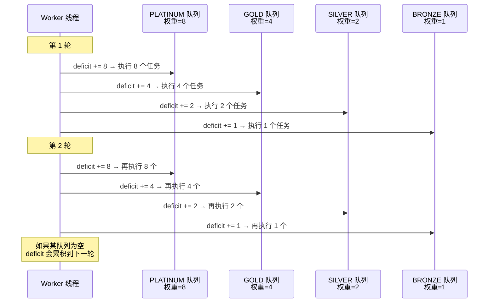

代码实现：

```java
private void workerLoop() {
    Map<String, Integer> deficitCounters = new HashMap<>(); // 每个 Worker 独立维护

    while (running) {
        boolean didWork = false;

        // Phase 1: DRR 调度
        for (Map.Entry<String, TenantContext> entry : tenants.entrySet()) {
            String tenantId = entry.getKey();
            TenantContext ctx = entry.getValue();

            // 累加 deficit
            deficitCounters.merge(tenantId, ctx.tier.weight, Integer::sum);

            int deficit = deficitCounters.getOrDefault(tenantId, 0);
            while (deficit > 0) {
                ScheduledTask<?> task = ctx.taskQueue.poll();
                if (task == null) break;  // 队列空了，deficit 保留到下一轮

                executeTask(ctx, task);
                deficit--;
                didWork = true;
            }
            deficitCounters.put(tenantId, Math.max(0, deficit));
        }

        // Phase 2: Work-Stealing
        if (!didWork) {
            didWork = tryWorkStealing();
        }

        // Phase 3: 无任务时休眠 1ms
        if (!didWork) {
            Thread.sleep(1);
        }
    }
}
```

**关键设计点：`deficitCounters` 是每个 Worker 线程的局部变量，不是共享状态。** 这意味着 8 个 Worker 线程各自独立做 DRR 调度，完全无锁。虽然不如全局共享 deficit 那么"精确公平"，但在高并发下性能好得多——这是一个典型的"精确性 vs 性能"的工程权衡。

### 5.2 Work-Stealing——不让任何线程闲着

当一个 Worker 在 DRR 轮次中没有拿到任何任务时，它不会傻等，而是去"偷"：

```java
private boolean tryWorkStealing() {
    TenantContext busiest = null;
    int maxDepth = 0;

    // 找到队列最深的租户
    for (TenantContext ctx : tenants.values()) {
        int depth = ctx.currentQueueDepth();
        if (depth > maxDepth) {
            maxDepth = depth;
            busiest = ctx;
        }
    }

    // 从最繁忙的队列偷一个任务
    if (busiest != null) {
        ScheduledTask<?> stolen = busiest.taskQueue.poll();
        if (stolen != null) {
            executeTask(busiest, stolen);
            return true;
        }
    }
    return false;
}
```

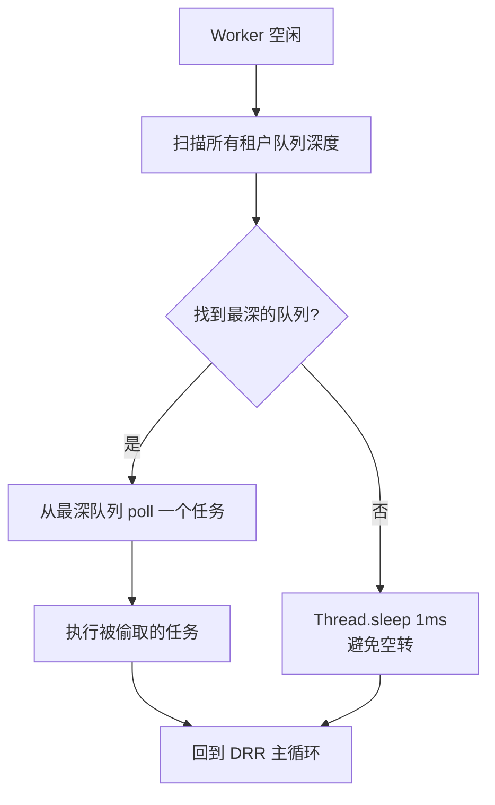

Work-Stealing 的好处是**自动负载均衡**：如果某个租户突然来了一波流量，它的队列会迅速变深，空闲的 Worker 会自动过来帮忙消化。这比静态分配"每个 Worker 负责哪些租户"灵活得多。

### 5.3 三阶段调度的完整流程

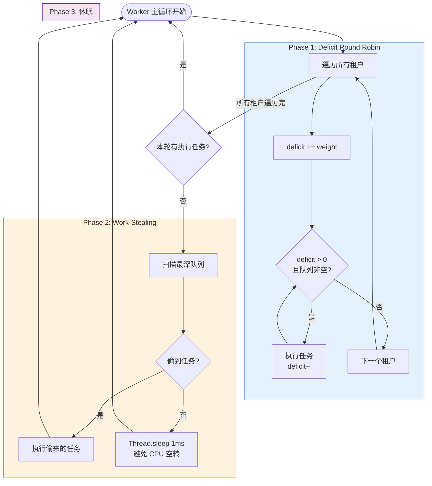


## 六、熔断与自愈：executeTask 中的状态机驱动

任务执行不仅仅是 `task.run()`，还承担着熔断器状态转换和指标采集的职责：

```java
private void executeTask(TenantContext ctx, ScheduledTask<?> task) {
    // 采集调度延迟
    long scheduleLatencyMicros = (System.nanoTime() - task.enqueueTimeNano) / 1000;
    ctx.scheduleLatency.record(scheduleLatencyMicros);

    try {
        task.run();
        ctx.completedCount.incrementAndGet();

        // 熔断恢复：HALF_OPEN 状态下成功 → 回到 CLOSED
        if (ctx.circuitState == CircuitState.HALF_OPEN) {
            ctx.circuitState = CircuitState.CLOSED;
            ctx.consecutiveFailures.set(0);
        }
    } catch (Exception e) {
        int failures = ctx.consecutiveFailures.incrementAndGet();
        ctx.lastFailureTimestamp = System.currentTimeMillis();

        // 连续失败 ≥ 5 次 → 触发熔断
        if (failures >= 5) {
            ctx.circuitState = CircuitState.OPEN;
        }
    }
}
```

熔断器的完整生命周期：

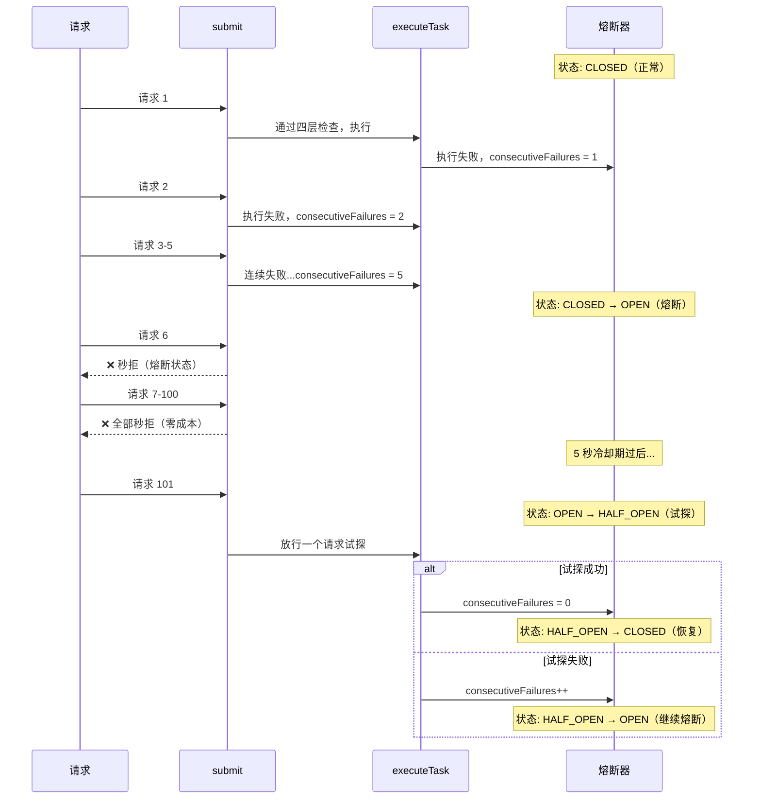

### 为什么用 volatile 而不是 AtomicReference？

`circuitState` 字段用的是 `volatile`：

```java
volatile CircuitState circuitState = CircuitState.CLOSED;
```

这是一个有意的选择：
- 熔断器状态转换是**单向的、低频的**（不是每个请求都会改变状态）
- `volatile` 保证可见性就够了，不需要 CAS 的原子性
- 即使两个线程同时把状态从 HALF_OPEN 改为 CLOSED，结果也是正确的（幂等操作）
- 比 `AtomicReference` 少一层间接引用，读取更快

这是一个典型的"够用就好"的工程判断——不是所有并发场景都需要最强的同步原语。

## 七、自适应控制器：系统的"自主神经"

每秒执行一次的自适应控制器，是整个引擎的"大脑"：

```java
private void adaptiveControl() {
    // 计算系统负载 = 所有队列深度之和 / 总容量
    long totalDepth = tenants.values().stream()
            .mapToLong(TenantContext::currentQueueDepth).sum();
    long totalCapacity = tenants.values().stream()
            .mapToLong(ctx -> ctx.tier.maxQueueDepth).sum();

    currentSystemLoad = totalCapacity > 0 ? (double) totalDepth / totalCapacity : 0;

    // 通知所有令牌桶调整速率
    tenants.values().forEach(ctx -> ctx.tokenBucket.adjustFactor(currentSystemLoad));
}
```

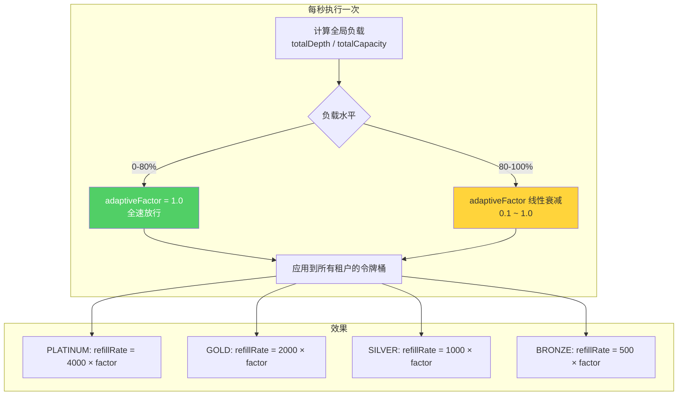

这个设计形成了一个**负反馈回路**：


这就是控制论中的**比例控制器（P-Controller）**——偏差越大，修正力度越大。系统会自动趋向一个动态平衡点。

## 八、P50/P99 延迟追踪：无锁直方图

监控是生产系统的眼睛。`LatencyTracker` 用 `ConcurrentSkipListMap` 实现了一个无锁的直方图：

```java
public static class LatencyTracker {
    private final ConcurrentSkipListMap<Long, AtomicInteger> histogram = new ConcurrentSkipListMap<>();
    private final AtomicLong totalCount = new AtomicLong();

    void record(long latencyMicros) {
        long bucket = (latencyMicros / 100) * 100; // 100μs 粒度桶化
        histogram.computeIfAbsent(bucket, k -> new AtomicInteger()).incrementAndGet();
        totalCount.incrementAndGet();
    }

    long getPercentile(double percentile) {
        long target = (long) (totalCount.get() * percentile);
        long cumulative = 0;
        for (Map.Entry<Long, AtomicInteger> entry : histogram.entrySet()) {
            cumulative += entry.getValue().get();
            if (cumulative >= target) return entry.getKey();
        }
        return 0;
    }
}
```

**为什么用 `ConcurrentSkipListMap` 而不是 `ConcurrentHashMap`？**

因为计算百分位数需要**有序遍历**。`ConcurrentSkipListMap` 的 key 天然有序，遍历时从小到大累加，到达目标百分位就返回。`ConcurrentHashMap` 无序，需要额外排序。

**100μs 的桶粒度是怎么选的？**

- 太细（1μs）：桶太多，内存爆炸
- 太粗（10ms）：精度不够，P99 没有参考价值
- 100μs：对于微服务场景，足够区分"快"和"慢"，同时内存可控（即使延迟分布在 0-1s，也只有 10000 个桶）

## 九、流量模拟：真实场景的压力测试

`main` 方法模拟了四种真实的流量模式：

```mermaid
gantt
    title 10 秒流量模拟时间线
    dateFormat X
    axisFormat %s秒

    section netflix-api (PLATINUM)
    稳定 200 RPS :active, 0, 10

    section partner-cdn (GOLD)
    稳定 100 RPS :active, 0, 10

    section analytics (SILVER)
    正常 50 RPS :0, 3
    突发 500 RPS :crit, 3, 6
    正常 50 RPS :6, 9
    突发 500 RPS :crit, 9, 10

    section free-trial (BRONZE)
    稳定 30 RPS :active, 0, 10
```

其中 analytics 租户的突发流量（50 → 500 RPS，10 倍突增）是最有意思的测试场景。它会触发：

1. **令牌桶快速耗尽**：SILVER 的令牌桶容量只有 2000，补充速率 1000/s，500 RPS 的突发会在约 4 秒内耗尽
2. **队列快速填满**：maxQueueDepth = 200，如果消费速度跟不上，很快触发背压
3. **自适应控制器介入**：全局负载上升，所有租户的令牌补充速率下降
4. **Work-Stealing 启动**：analytics 队列变深，空闲 Worker 自动过来帮忙

这个场景完美展示了各个组件如何协同工作。

### 流量生成的精度控制

```java
private static void busyWaitMicros(long micros) {
    long waitUntil = System.nanoTime() + micros * 1000;
    while (System.nanoTime() < waitUntil) {
        Thread.onSpinWait(); // JDK 9+ CPU hint
    }
}
```

为什么用忙等待而不是 `Thread.sleep`？因为 `Thread.sleep` 的最小粒度是 ~1ms（受操作系统调度器影响），而 200 RPS 需要 5ms 间隔、500 RPS 需要 2ms 间隔。忙等待虽然消耗 CPU，但能提供微秒级精度，保证流量模拟的准确性。

`Thread.onSpinWait()` 是 JDK 9 引入的 CPU hint，告诉处理器"我在自旋等待"，处理器可以降低功耗或让出超线程资源。

## 十、数据结构选型总结

| 组件 | 数据结构 | 选型理由 |
|------|----------|----------|
| 租户注册表 | `ConcurrentHashMap` | O(1) 查找，高并发读写 |
| 任务队列 | `PriorityBlockingQueue` | 自动按优先级排序，线程安全 |
| 令牌计数 | `AtomicLong` | CAS 无锁，纳秒级操作 |
| 延迟直方图 | `ConcurrentSkipListMap` | 有序遍历计算百分位数 |
| 失败计数 | `AtomicInteger` | 无锁递增/归零 |
| 熔断状态 | `volatile enum` | 低频写、高频读，可见性足够 |
| deficit 计数器 | `HashMap`（线程局部） | 每个 Worker 独立，无需并发 |
| 系统负载 | `volatile double` | 单写多读，可见性足够 |

## 十一、并发安全性分析

整个引擎的并发模型可以归纳为：

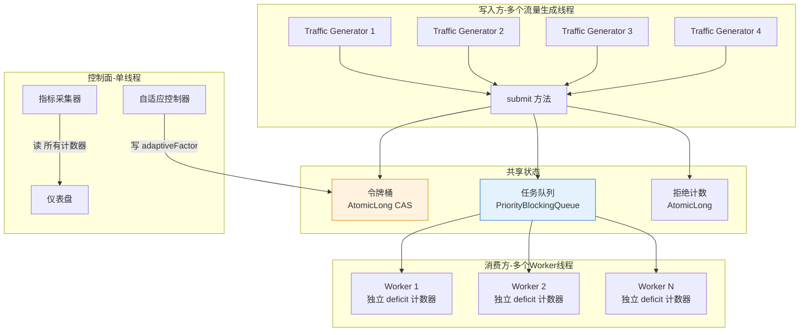

关键的并发安全保证：

1. **令牌桶**：`AtomicLong` + CAS 保证原子性，`volatile lastRefillTime` 保证可见性
2. **任务队列**：`PriorityBlockingQueue` 本身线程安全
3. **计数器**：全部使用 `AtomicLong/AtomicInteger`
4. **熔断状态**：`volatile` 保证可见性，状态转换是幂等的
5. **deficit 计数器**：线程局部变量，无需同步
6. **adaptiveFactor**：单线程写（自适应控制器）、多线程读（令牌桶），`volatile` 足够

**没有一把 `synchronized` 锁，没有一个 `ReentrantLock`。** 整个热路径（submit → 入队 → 出队 → 执行）全部是无锁或 lock-free 的。

## 十二、设计模式与架构思想总结

| 模式/思想 | 在引擎中的体现 |
|-----------|---------------|
| 分层防御（Defense in Depth） | submit 的四层检查链路 |
| 快速失败（Fail Fast） | 成本最低的检查放最前面 |
| 背压传播（Backpressure） | 队列深度超限时主动拒绝 |
| 熔断器模式（Circuit Breaker） | 三态状态机 + 自动恢复 |
| 令牌桶算法（Token Bucket） | CAS 无锁实现 + 自适应因子 |
| Deficit Round Robin | 加权公平调度，网络 QoS 经典算法 |
| Work-Stealing | 空闲线程主动偷取，自动负载均衡 |
| 负反馈控制（Feedback Control） | 自适应控制器形成闭环 |
| 关注点分离 | 数据面（Worker）与控制面（Controller）独立 |
| 异步编程 | CompletableFuture 非阻塞返回 |

## 十三、可以继续优化的方向

这个引擎已经是一个相当完整的实现，但在生产环境中还可以考虑：

1. **令牌桶的 refill 竞态**：多线程同时调用 `refill()` 时，`lastRefillTime` 的更新不是原子的，可能导致少量令牌多补或少补。可以用 CAS 保护 `lastRefillTime` 的更新。

2. **熔断器的并发状态转换**：多个线程可能同时将 OPEN 转为 HALF_OPEN，导致多个"试探请求"同时放行。可以用 `compareAndSet` 保证只有一个线程成功转换。

3. **队列深度检查与入队的非原子性**：`isQueueFull()` 和 `taskQueue.offer()` 之间有时间窗口，可能导致队列实际深度略超 `maxQueueDepth`。在实践中这个误差可以接受，但如果需要严格控制，可以用 `Semaphore` 做精确的容量控制。

4. **指标采集的内存增长**：`LatencyTracker` 的直方图会持续增长，长时间运行后需要考虑滑动窗口或定期重置。

5. **更精细的 Work-Stealing 策略**：当前是从最深的队列偷取，可以考虑加入租户权重因素——优先偷取高权重租户的任务。

## 十四、总结

这个多租户调度引擎的核心设计哲学可以用一句话概括：

> **用最小代价、在最早的时机，把不该进来的请求挡在门外，同时保证高等级租户永远比低等级租户更难被拒绝。**

它不是某一个算法的胜利，而是多个经典算法和设计模式的精心编排：

- **入口层**用分层漏斗做快速失败
- **调度层**用 DRR + Work-Stealing 做加权公平
- **控制层**用负反馈回路做自适应调节
- **保护层**用熔断器做优雅降级

每一层都在做自己最擅长的事，组合在一起就形成了一个能扛住十万级 QPS、在过载时优雅降级而不是雪崩的调度系统。
